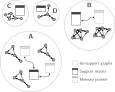

# Implementation

These pages describe how barry works internally: how it stores support sets
and how it computes exact likelihoods. They are written in Markdown with
GitHub-compatible math (`$...$` and fenced `math` blocks), so they render the
same on GitHub and on this site.

See [Likelihood, gradient, and Hessian](likelihood-derivatives.md) for the
derivation of the exact log-likelihood and its derivatives, their implementation,
and an example.

## Efficient memory usage

In pooled-data models, barry avoids computing and storing the same support
more than once. It keeps track of which arrays (for example, networks) share
a support, and stores each unique support only once.

{ width="100%" }

## Adding a page

1. Add a Markdown file under `docs/impl/`.
2. List it under `Implementation` in the `nav` section of `mkdocs.yml`.
3. Preview it with `make preview`.
