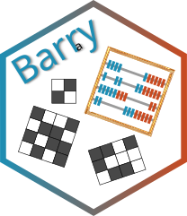

# barry: your go-to motif accountant

{ align=right width="180" }

--8<-- "README.md:intro"

## Where to go next

- **[Getting Started](getting-started.md)**: examples of counting statistics,
  and how to build and run the tests.
- **[Implementation](impl/index.md)**: how barry represents supports and
  computes exact likelihoods.
- **[API Reference](api/index.md)**: classes, namespaces, and files, generated
  from the Doxygen comments in the headers.

## Related software

- [barryr](https://github.com/USCbiostats/barryr): the barry headers packaged
  for use in R packages (`LinkingTo: barry`).
- [defm](https://github.com/UofUEpiBio/defm): R package for Discrete
  Exponential-Family Models built on barry.
- [ergmito](https://github.com/muriteams/ergmito): exact-likelihood ERGMs for
  small networks.
